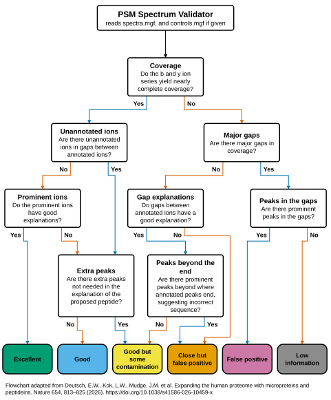

# PSM Spectrum Validator

A single, self-contained web page for judging peptide-spectrum matches (PSMs) by eye. It walks one annotated MS/MS
spectrum at a time through a flowchart of eight questions, from coverage by b and y ions to one of six verdicts, and
compares each of your answers with a rule-based reference model.

- [Open the validator](https://aramburu-lab.github.io/psm-spectrum-validator/spectrum_validator.html), with nothing to
  install. The spectra you load are read in your browser and never leave your computer.
- [Follow the step-by-step guide](https://aramburu-lab.github.io/psm-spectrum-validator/guide.html) from a finished
  FragPipe search to judged spectra. It shows one instruction at a time and writes each command for your computer and
  your own folders.
- [See the flowchart animated](https://aramburu-lab.github.io/psm-spectrum-validator/flowchart.html): the files it
  reads, then a stream through the questions to each verdict.

## Making the input files from FragPipe

`scripts/python/export_mgf.py` turns a finished FragPipe search into the MGF files the validator loads. It runs with
Docker, which needs nothing else installed, or with Python 3.10 or newer; [the guide](guide.html) gives the commands
for either. `python scripts/python/export_mgf.py --help` lists every option, and `--selftest` checks an installation.

It reads each experiment's `psm.tsv` and each run's spectra: the `<run>_uncalibrated.mzML` MSFragger writes beside a
Thermo `.raw` file, or the `<run>.mzML` that was searched. Bruker `.d` input is not read. The export never uses the
network.

`requirements.txt` names the two packages it imports. The `Dockerfile` installs them with every other package fixed
at the version tested, as `constraints.txt` lists.

## Where the flowchart comes from

The flowchart of questions and verdicts is adapted from:

> Deutsch, E.W., Kok, L.W., Mudge, J.M. et al. Expanding the human proteome with microproteins and peptideins.
> *Nature* 654, 813–825 (2026). https://doi.org/10.1038/s41586-026-10459-x

Please cite that paper when you use or describe the flowchart. The reference model's rules and some question wordings
are this tool's own interpretation of it, so a verdict here is not a verdict of the paper's authors.

## Feedback

Use **Help make this tool better** at the top of the page, or **Have a different opinion?** under any reply of the
reference model. Each saves a text note with the tool's version and settings. Post it as an
[issue here](https://github.com/Aramburu-Lab/psm-spectrum-validator/issues), or email it to rytis.stakaitis@umu.se.

## License

MIT, see [LICENSE](LICENSE).
